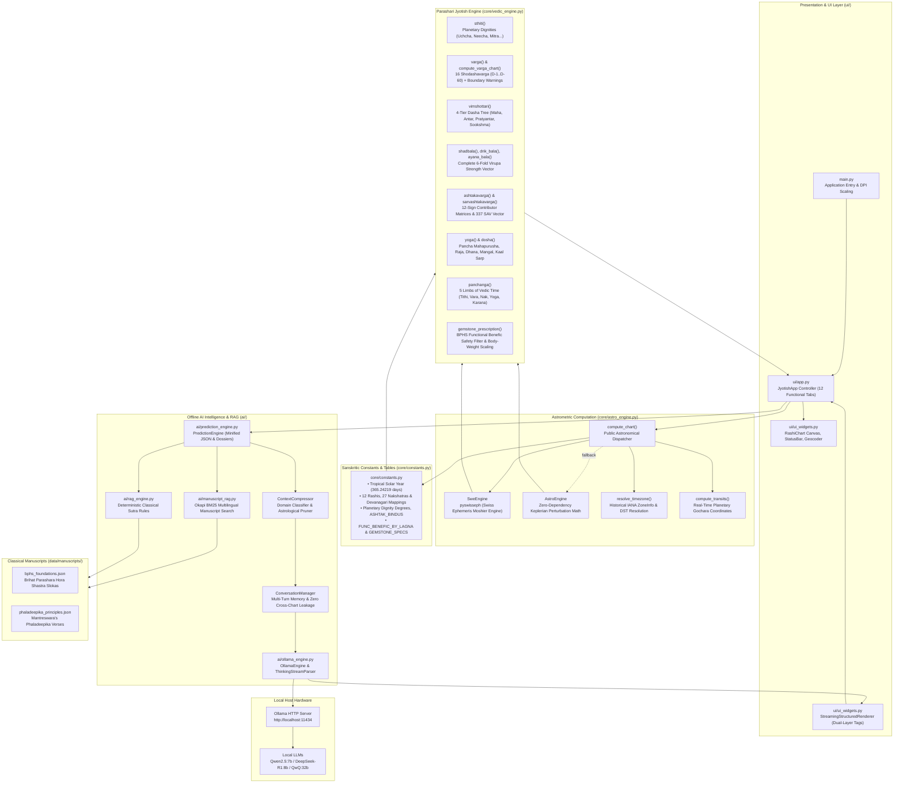
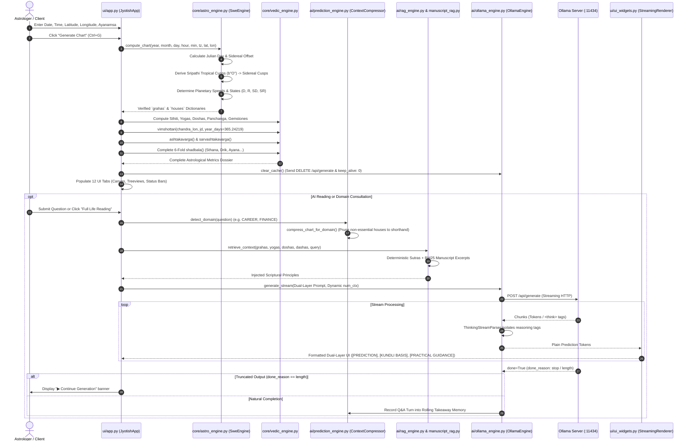
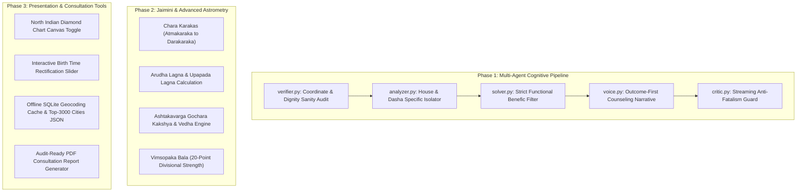

# Vedic Astrology Calculator & Offline AI Jyotishi 🪐

[](https://www.python.org/)
[-orange.svg)](https://www.astro.com/swisseph/)
[-green.svg)](https://ollama.ai/)
[](#)
[](#)
[](LICENSE)

An open-source, high-precision Vedic Astrology (**Parashari Jyotish**) calculation suite and offline, privacy-first **Neuro-Symbolic Artificial Intelligence Reasoning System**. 

Engineered for professional astrologers, computational researchers, and developers who demand sub-arcsecond celestial mechanics, strict fidelity to classical Sanskrit shastras (*Brihat Parashara Hora Shastra*, *Phaladeepika*, *Saravali*), zero external cloud dependencies, and explainable AI consultations without cross-chart memory contamination.

---

## 📑 Table of Contents

1. [Executive Vision & Philosophy](#-executive-vision--philosophy)
2. [High-Level System Architecture](#-high-level-system-architecture)
3. [End-to-End Prediction & Inference Pipeline](#-end-to-end-prediction--inference-pipeline)
4. [File-by-File & Module-Divided Deep Dive](#-file-by-file--module-divided-deep-dive)
   - [Core Astronomical Mechanics (`core/astro_engine.py`)](#1-coreastro_enginepy)
   - [Classical Parashari Vedic Math Engine (`core/vedic_engine.py`)](#2-corevedic_enginepy)
   - [Constants, Dignity Tables & Safety Prescriptions (`core/constants.py`)](#3-coreconstantspy)
   - [Context Compression & Prompt Engineering (`ai/prediction_engine.py`)](#4-aiprediction_enginepy)
   - [Offline Ollama Streaming & Thinking Parser (`ai/ollama_engine.py`)](#5-aiollama_enginepy)
   - [Deterministic Scriptural Knowledge Retrieval (`ai/rag_engine.py`)](#6-airag_enginepy)
   - [Multilingual Okapi BM25 Manuscript RAG (`ai/manuscript_rag.py`)](#7-aimanuscript_ragpy)
   - [Classical Manuscript Knowledge Corpus (`data/manuscripts/`)](#8-datamanuscripts)
   - [Brutalist UI Application Controller (`ui/app.py`)](#9-uiapppy)
   - [Custom Canvas Charts & Structured Renderer (`ui/ui_widgets.py`)](#10-uiui_widgetspy)
   - [Bootstrap & Platform DPI Handler (`main.py`)](#11-mainpy)
   - [Automated Verification & Test Suite (`tests/`)](#12-tests)
5. [Complete Repository File Reference Matrix](#-complete-repository-file-reference-matrix)
6. [Comprehensive System Analysis & Gaps](#-comprehensive-system-analysis--gaps)
7. [Modernization & Upgrades Roadmap](#-modernization--upgrades-roadmap)
8. [Installation, Setup & Verification](#-installation-setup--verification)
9. [Local Model Configuration (Ollama)](#-local-model-configuration-ollama)
10. [License & Acknowledgments](#-license--acknowledgments)

---

## 🔭 Executive Vision & Philosophy

Modern computational astrology often suffers from two opposing failure modes:
1. **Opaque Black-Box Calculators**: Closed-source software with undisclosed orbital approximations, mixed tropical/sidereal coordinate drift, and dogmatic rule engines that cannot explain their calculations.
2. **Hallucinatory Generic LLMs**: Cloud-based AI systems that confidently invent nonexistent planetary placements, recommend contraindicated gemstones that aggravate malefic houses, or generate fatalistic predictions without classical justification.

This repository resolves both failures through the **Dual-Engine Neuro-Symbolic Paradigm**:

```
┌────────────────────────────────────────────────────────────────────────────────────────┐
│                          THE DUAL-ENGINE NEURO-SYMBOLIC PARADIGM                       │
│                                                                                        │
│   [ User Birth Input ] ──▶ [ Geographical Coordinates & IANA Historical Timezone ]     │
│                                           │                                            │
│                                           ▼                                            │
│   ┌────────────────────────────────────────────────────────────────────────────────┐   │
│   │                     DETERMINISTIC SYMBOLIC FOUNDATION (core/)                  │   │
│   │                                                                                │   │
│   │   • Swiss Ephemeris C-Moshier orbital physics (<0.1 arcsecond precision)       │   │
│   │   • Sidereal Ayanamsa Engine (Lahiri Chitrapaksha, Raman, KP)                  │   │
│   │   • Sripathi unequal Bhava Chalit cusps (tropical quadrant arc trisection)     │   │
│   │   • True vs Mean lunar node orbital tracking & stationary speed detection      │   │
│   │   • 16 Shodashavarga divisional charts (D-1 to D-60) with boundary checks      │   │
│   │   • 120-year Vimshottari Dasha lifecycles (Tropical year = 365.24219 days)     │   │
│   │   • 6-fold Shadbala virupa calculations & 337-point Sarvashtakavarga matrix    │   │
│   │   • Classical BPHS functional benefic safety filters for gemstone remediation  │   │
│   └───────────────────────────────────────┬────────────────────────────────────────┘   │
│                                           │ Verified Mathematical Dossier              │
│                                           ▼                                            │
│   ┌────────────────────────────────────────────────────────────────────────────────┐   │
│   │                    OFFLINE NEURAL EXPLAINABILITY LAYER (ai/)                   │   │
│   │                                                                                │   │
│   │   • 40% Token Minification (removes redundant floats and raw arcminutes)       │   │
│   │   • Semantic Domain Classifier (prunes irrelevant houses to 1-line shorthand)  │   │
│   │   • Hybrid Scriptural RAG (Deterministic sutras + BM25 multilingual search)    │   │
│   │   • Thinking Token Parser (isolates <think> tags for DeepSeek-R1 / QwQ)        │   │
│   │   • Dual-Layer Explainable Output ([SECTION], [PREDICTION], [KUNDLI BASIS])    │   │
│   │   • Dynamic VRAM Budgeting & Hardware KV-cache eviction (Zero native leakage)  │   │
│   └────────────────────────────────────────────────────────────────────────────────┘   │
└────────────────────────────────────────────────────────────────────────────────────────┘
```

---

## 🏛️ High-Level System Architecture

The following diagram illustrates the complete data flow from client inputs to astronomical coordinate computation, Parashari mathematical transformations, offline neural RAG retrieval, and brutalist UI presentation.



---

## 🔄 End-to-End Prediction & Inference Pipeline

The following sequence illustrates the exact execution lifecycle when an astrologer inputs a birth chart and requests an AI life consultation:



---

## 🔍 File-by-File & Module-Divided Deep Dive

### 1. `core/astro_engine.py`

#### Responsibilities & Design
Acts as the celestial mechanics core of the system. Performs orbital computations, coordinate transformations, house cusp calculations, and historical timezone offsets.

#### Key Implementations

- **`SweEngine`**: Primary astrometric calculation engine using `pyswisseph` (C-based Swiss Ephemeris in Moshier mode, operating autonomously without external `.se1` ephemeris files):
  - **`_to_jd(y, mo, d, h, mi, tz)`**: Converts local calendar time to Julian Day (UT) using astronomical algorithms.
  - **`compute(...)`**: Calculates sidereal planetary longitudes and speeds for Sun through Ketu. Supports **Lahiri (Chitrapaksha)**, **Raman**, and **Krishnamurti (KP)** ayanamsas.
  - **True vs Mean Node Engine**: When `node_type == "True"`, computes Rahu via `swe.TRUE_NODE` and derives Ketu's orbital velocity independently from the opposite node ephemeris position (`xx_k[3]`), rather than cloning Rahu's velocity vector.
  - **Stationary Motion Detection**: Classifies planetary speed into 4 states using `STATIONARY_SPD_DEG = 0.001°/day`:
    - `"D"`: Direct motion ($speed > 0$).
    - `"R"`: Retrograde motion ($speed < 0$).
    - `"SD"`: Stationary Direct (slowing to a halt from negative direction).
    - `"SR"`: Stationary Retrograde (slowing to a halt from positive direction).
  - **Sripathi (Porphyry) Cusp Derivation**: Computes house cusps in tropical coordinates via `swe.houses(jd, lat, lon_geo, b"O")`. The Porphyry method trisects the quadrant arcs between Ascendant and Midheaven (MC), corresponding exactly to classical Parashari *Sripathi* doctrine. It subtracts the Ayanamsa from **all 12 cusps**, eliminating mixed-zodiac bugs.
  - **Polar Latitude Protection**: When $|latitude| > 60.0^\circ$, ecliptic arcs collapse. The engine detects this threshold and automatically falls back to geometric Equal House cusps ($30^\circ$ increments from Lagna), tagging the result as `bhava_method = "equal_house_polar_fallback"`.

- **`AstroEngine`**: Autonomous, zero-dependency analytical mathematical fallback written in pure Python. Employs Keplerian orbital elements and periodic perturbation equations:
  - **`_sun_lon(jd)`**: High-precision solar longitude with equation-of-center corrections.
  - **`_moon_lon(jd)`**: Lunar theory incorporating 36 Delaunay perturbation terms ($D, M, M', F$).
  - **`_kepler(M, e)`**: Solves Kepler's transcendental equation ($E = M + e \sin E$) via iterative Newton-Raphson approximations.
  - **`_planet_lon(name, jd)`**: Computes heliocentric orbital coordinates for Mercury through Saturn, converting them to geocentric longitudes with light-time travel compensations.
  - **`_lahiri(jd)`**: Analytical approximation of the Lahiri precession angle ($23.85^\circ + T \times 100 \times \frac{50.29''}{3600''}$).
  - **`_lagna(jd, lat, lon_geo)`**: Calculates sidereal Ascendant via GMST, LST, and ecliptic obliquity ($\epsilon$).

- **`resolve_timezone(iana_tz_name, y, mo, d, h, mi)`**: Inspects Python's standard `zoneinfo.ZoneInfo` against the IANA timezone database. Returns decimal UTC offset, daylight saving status (`is_dst`), and official abbreviation (`tz_abbr`).
- **`compute_transits(ayanamsa_key, lat, lon)`**: Calculates instantaneous sidereal planetary positions for the current UTC moment to overlay live *Gochara* transits on the natal chart.

---

### 2. `core/vedic_engine.py`

#### Responsibilities & Design
The classical mathematical and algorithmic engine of Parashari Jyotish. Translates raw planetary longitudes into dignities, divisional coordinates, dasha lifecycles, planetary strengths, yogas, doshas, and remedies.

#### Key Implementations & Algorithms

1. **Planetary Dignity (`sthiti`)**:
   - Evaluates dignity for all 9 grahas (including Rahu/Ketu).
   - Validates `"Uchcha"` (Exaltation) and `"Neecha"` (Debilitation) against degree boundaries in `UCHCHA_DEG` and `NEECHA_DEG`.
   - Checks `"Moolatrikona"` and `"Swakshetra"` (Own sign).
   - Derives `"Mitra"` (Friend), `"Sama"` (Neutral), and `"Shatru"` (Enemy) based on natural relationship matrices (`MITRA`, `SHATRU`).

2. **16 Shodashavarga Divisional Charts (`varga` & `compute_varga_chart`)**:
   - Computes all 16 canonical divisional charts specified in BPHS Chapter 6:
     $$\text{Segment Size} = \frac{30^\circ}{n}, \quad k = \lfloor \frac{d \cdot n}{30^\circ} \rfloor$$
   - **D-1 (Rasi)**: Physical self and vitality.
   - **D-2 (Hora)**: Wealth and resources (BPHS Sun/Moon division).
   - **D-3 (Drekkana)**: Siblings, courage, decanates ($0^\circ, +4, +8$ signs).
   - **D-4 (Chaturthamsha)**: Fixed assets, home, landed property.
   - **D-7 (Saptamsha)**: Progeny, children, creative legacy.
   - **D-9 (Navamsa)**: Soul purpose, marriage, dharmic destiny ($(r \cdot 9 + pada) \bmod 12$).
   - **D-10 (Dashamsha)**: Career, profession, institutional status.
   - **D-12 (Dwadashamsha)**: Parents, ancestry, lineage karma.
   - **D-16 (Shodashamsha)**: Vehicles, conveyances, material happiness.
   - **D-20 (Vimshamsha)**: Spiritual progress, devotion, upasana.
   - **D-24 (Chaturvimshamsha)**: Higher learning, intellectual scholarship.
   - **D-27 (Bhamsha / Saptavimshamsha)**: Innate strength, physical stamina.
   - **D-30 (Trishamsha)**: Misfortunes, karmic debt, chronic vulnerabilities (implements classical unequal odd/even degree spans: Mars $5^\circ$, Saturn $5^\circ$, Jupiter $8^\circ$, Mercury $7^\circ$, Venus $5^\circ$).
   - **D-40 (Khavedamsha)**: Maternal lineage auspiciousness.
   - **D-45 (Akshavedamsha)**: Paternal lineage character.
   - **D-60 (Shashtiamsha)**: Root past-life karma (60 subdivisions of $0.5^\circ$ each).
   - **`check_varga_boundary(lon, n, threshold=0.05)`**: Evaluates whether a natal planet sits within $\pm 0.05^\circ$ of a division boundary, alerting the astrologer to birth-time sensitivity.

3. **Vimshottari Dasha Engine (`vimshottari` & `compute_pratyantardasha_for_ad`)**:
   - Models the 120-year cycle of human longevity based on Moon's nakshatra longitude.
   - **Tropical Solar Year Formulation**: Enforces `TROPICAL_YEAR = 365.24219` days per solar year, preventing the 15–20 day cumulative drift caused by standard $365.25\text{d}$ approximations over a 60-year lifespan.
   - **4 Nesting Depths**: Mahadasha (L1), Antardasha (L2), Pratyantardasha (L3), Sookshmadasha (L4).
   - **On-Demand Tree Expansion**: Employs `current_only_sub=True` to expand levels 3 and 4 exclusively around the current date, with dynamic branch expansion on Treeview double-click.
   - **`format_dasha_balance(start_dt, birth_dt)`**: Formats birth balance into exact `"Xy Ym Zd"` format.

4. **Complete 6-Fold Shadbala Engine (`shadbala`, `drik_bala`, `ayana_bala`)**:
   - **Sthana Bala (Positional)**: Uchcha Bala (distance from debilitation point, $0\text{--}60$ virupas), Ojhayugmarashi Bala ($15$ virupas), Drekkana Bala ($0\text{--}60$ virupas), Kendradi Bala ($60, 30, 15$ virupas using Sripathi cusps).
   - **Saptavarga Bala**: Dignity aggregate across 7 fundamental divisional charts.
   - **Cheshta Bala (Motional)**: Motional strength based on retrograde state ($60$ virupas for retro, or inversely scaled with speed).
   - **Naisargika Bala (Natural)**: Inherent luminosity hierarchy (Sun $60$, Moon $51.43$, Venus $42.86$, Jupiter $34.29$, Mercury $25.71$, Mars $17.14$, Saturn $8.57$).
   - **Drik Bala (Aspectual)**: Mutual planetary aspect angles. Evaluates special aspects for Mars ($4, 7, 8$), Jupiter ($5, 7, 9$), Saturn ($3, 7, 10$), and others ($7$). Benefics add virupas; malefics deduct virupas.
   - **Ayana Bala (Declination)**: Evaluates equatorial declination ($\delta$). Benefics gain strength with northern declination; malefics gain with southern declination.

5. **Ashtakavarga & Sarvashtakavarga (`ashtakavarga`, `sarvashtakavarga`)**:
   - Computes 8-contributor benefic bindu matrices for the 7 classical planets across all 12 signs via `ASHTAK_BINDUS`.
   - Computes aggregate **Sarvashtakavarga (SAV)** vector (summing to 337 total bindus across 12 rashis), flagging signs with $\ge 28$ bindus as auspicious for transits.

6. **Classical Yoga & Dosha Detection (`yoga`, `dosha`)**:
   - **Yogas**: Gaja Kesari, 5 Pancha Mahapurusha (Hamsa, Ruchaka, Sasha, Malavya, Bhadra), Raja Yoga (Kendra-Trikona conjunctions), Dhana Yoga (2/5/9/11 lords), Budhaditya, Chandra-Mangal, Saraswati, Viparita Raja, Neechabhanga Raja Yoga.
   - **Doshas & Cancellations**:
     - *Mangal (Kuja) Dosha*: Houses 1, 2, 4, 7, 8, 12; evaluates 3 classical cancellation conditions (own/exalted sign, conjunction with Jupiter, conjunction with Moon).
     - *Kaal Sarp Dosha*: Hemmed between Rahu and Ketu; maps to 6 specific nodal axes (*Anant, Kulik, Vasuki, Shankhpal, Padma, Mahapadma*).
     - *Kemadruma Dosha*: No planets in 2nd and 12th from Moon; checks cancellation via planets in Kendras.
     - *Graha Yuddha*: Planetary war between visible bodies within $1.0^\circ$ orb.

7. **Panchanga Engine (`panchanga`)**:
   - **Tithi**: Solilunar separation ($(Moon - Sun) / 12.0^\circ$), Shukla/Krishna paksha, elapsed percentage.
   - **Vara**: Solar weekday and ruling graha.
   - **Nakshatra**: Lunar mansion ($0\text{--}26$), 4 padas, elapsed percentage.
   - **Nitya Yoga**: Solilunar sum ($(Moon + Sun) / (360/27)^\circ$), *Shubha* or *Ashubha*.
   - **Karana**: Half-tithi ($6.0^\circ$), 7 movable *Chara* and 4 fixed *Sthira* karanas, flagging inauspicious *Vishti (Bhadra)*.

8. **Gemstone Prescription Engine (`gemstone_prescription`)**:
   - Enforces the **BPHS Functional Benefic Safety Filter** (`FUNC_BENEFIC_BY_LAGNA`).
   - If a graha is a functional malefic (rules 6th, 8th, or 12th houses), the system **strictly contraindicates** physical gemstones and prescribes non-harmful alternatives (*Mantra Japa*, *Daana*, charity).
   - If benefic, computes recommended weight in carats based on native's body weight, specifying setting metal, wearing finger, auspicious day/hora, and consecration mantra.

---

### 3. `core/constants.py`

#### Responsibilities & Design
Single source of truth for static data dictionaries, lookup tables, Sanskritic naming, UI color palettes, and LLM configuration parameters. Zero internal imports.

#### Key Data Structures
- **Astronomical Constants**: `TROPICAL_YEAR = 365.24219`, `STATIONARY_SPD_DEG = 0.001`, `POLAR_LATITUDE_THRESHOLD = 60.0`, `BOUNDARY_THRESHOLD = 0.05`.
- **Zodiac & Mansions**: `RASHI`, `RASHI_DEVA` (Devanagari labels), `RASHI_ABBR`, `NAKSHATRA` (27 mansions in Devanagari), `NAK_LORDS`, `RASHI_SWAMI` (Sign rulers).
- **Planetary Dignities**: `UCHCHA_DEG`, `NEECHA_DEG`, `MOOLTRIKONA`, `SWAKSHETRA`, `MITRA`, `SHATRU`.
- **Dasha Cycles**: `DASHA_VARSH` (Vimshottari durations: Ketu 7, Venus 20, Sun 6, Moon 10, Mars 7, Rahu 18, Jupiter 16, Saturn 19, Mercury 17 = 120 years), `DASHA_KRAM`.
- **Safety Filters**: `FUNC_BENEFIC_BY_LAGNA` (Strict functional benefic mapping for all 12 ascendants).
- **Ashtakavarga Rules**: `ASHTAK_BINDUS` (Parashari contributor matrices for Sun through Saturn).
- **Panchanga Catalogues**: `TITHI_NAMES`, `NITYA_YOGAS`, `CHARA_KARANAS`, `STHIRA_KARANAS`, `VARA_NAMES`.
- **Gemstone Specifications**: `GEMSTONE_SPECS` (Primary gems, Sanskrit names, uparatnas, metals, fingers, consecration mantras).
- **Brutalist UI Palette**: `XP_BG` (`#121212`), `XP_SURFACE` (`#1E1E1E`), `XP_BORDER` (`#333333`), `XP_FIELD` (`#FFFFFF`), `XP_BLUE` (`#3B82F6`), `XP_BLUE2` (`#60A5FA`), `XP_BTN` (`#262626`), `XP_TEXT_D` (`#F5F5F5`), `XP_TEXT_M` (`#A1A1AA`).
- **Ollama Defaults**: `OLLAMA_BASE_URL` (`http://localhost:11434`), `OLLAMA_MAX_PREDICT` ($1600$), `OLLAMA_MAX_PREDICT_FULL` ($3200$), `OLLAMA_CTX_MIN` ($1024$), `OLLAMA_CTX_MAX` ($8192$).

---

### 4. `ai/prediction_engine.py`

#### Responsibilities & Design
Coordinates LLM prompt construction, semantic domain routing, intelligent chart minification, and multi-turn conversational context compression.

#### Key Classes & Functions

- **`PredictionEngine`**:
  - **`chart_json(grahas, yogas, doshas, dashas)`**: Produces an aggressively minified JSON payload for 7B/9B local LLMs. Strips redundant degree floats and raw arcminutes, saving $\sim 40\%$ token overhead while preserving essential semantic nodes (bhava, rashi, dignity, nakshatra lord, retro flag, active dasha timeline, detected yogas, and doshas).
  - **`chart_text_full(...)`**: Formats a detailed human-readable ASCII dossier for export or plain-text viewing.
  - **`system_prompt()`**: Implements the **Dual-Layer Explainable AI Format**. Enforces ethical safety boundaries: strictly forbids predicting death, terminal illnesses, or bankruptcy. Directs the model to structure every consultation section using four required tags:
    - `[SECTION: <Domain>]`
    - `[PREDICTION]: <Empathetic natural language for the client>`
    - `[KUNDLI BASIS]: <Technical reasoning: house lords, aspects, dasha timing, scriptural citation>`
    - `[PRACTICAL GUIDANCE]: <Constructive actionable guidance or psychological reframe>`
  - **`extract_temporal_context(dashas, grahas, question)`**: Detects explicit calendar years (e.g., "1998", "2015") or retrospective keywords ("childhood", "previous dasha") in the user's question, constructing a retrospective record identifying which Mahadasha and Antardasha lords were running during that specific period.

- **`ContextCompressor`**:
  - **`detect_domain(text)`**: Categorizes user questions into one of 8 specialized domains: `CAREER`, `RELATIONSHIPS`, `FINANCE`, `HEALTH`, `EDUCATION`, `TIMING_DASHA`, `REMEDIES`, or `GENERAL`.
  - **`compress_chart_for_domain(chart_json_str, domain)`**: Performs intelligent semantic pruning. Isolates domain-pertinent bhavas (e.g., houses 1, 2, 6, 10, 11 for `CAREER`) and domain significators (e.g., Sun, Mercury, Saturn, Jupiter). Retains full JSON fidelity for pertinent houses, active dasha lords, and Lagna, compressing irrelevant placements into a compact one-line shorthand string (e.g., `"Ve:B9(Pis,Uch)"`).
  - **`extract_takeaways(answer_text, max_bullets=2)`**: Extracts high-level conclusions from prior answers for rolling conversational memory.

- **`ConversationManager`**:
  - **`reset_for_new_chart(chart_id, chart_name)`**: Completely flushes conversation history and clears cached findings when a new chart is calculated or loaded, preventing context leakage between clients.
  - **`build_qa_prompt(raw_chart_json_str, question, classical_doctrine)`**: Constructs a compressed prompt combining domain-pruned chart JSON, scriptural sutras, rolling historical takeaways, and the native's query.
  - **`record_turn(question, answer_text, domain)`**: Records Q&A dialogue turns and updates rolling takeaway memory (capped at 6 items).

---

### 5. `ai/ollama_engine.py`

#### Responsibilities & Design
Provides fully offline, streaming HTTP communication with local Ollama instances. Features thinking-tag isolation for reasoning models (DeepSeek-R1, QwQ), dynamic context budgeting, and GPU VRAM purging.

#### Key Classes & Functions

- **`ThinkingStreamParser`**: A sliding-window token parser that intercepts incoming LLM stream chunks:
  - Detects opening `<think>` and closing `</think>` tags even if split across chunk boundaries (e.g. chunk 1: `"<thi"`, chunk 2: `"nk>"`).
  - Suppresses reasoning tokens from the primary user prediction stream.
  - Routes reasoning tokens to an optional `thinking_cb`, allowing opt-in inspection in the UI while keeping the client prediction view clean.

- **`_dynamic_ctx(system_prompt, user_prompt, max_predict)`**: Calculates the minimum required context window ($num\_ctx$) based on prompt character length and output token budget. Clamps between `OLLAMA_CTX_MIN` ($1024$) and `OLLAMA_CTX_MAX` ($8192$), maximizing inference speed and minimizing VRAM allocation on 8GB/12GB consumer GPUs.

- **`OllamaEngine`**:
  - **`ping(base_url)`**: Checks Ollama connectivity via `GET /api/tags`.
  - **`list_models(base_url)`**: Enumerates locally available LLM models.
  - **`clear_cache(model, base_url)`**: Evicts model KV cache from GPU memory by sending an HTTP `DELETE` to `/api/generate` and invoking a dummy request with `keep_alive: 0`.
  - **`generate_stream(...)`**: Connects to `POST /api/generate` with `"stream": True`, dispatches tokens to `ThinkingStreamParser`, monitors completion metadata (`done_reason`), signals UI for continuations on length cutoffs, and supports mid-generation cancellation via `threading.Event`.

---

### 6. `ai/rag_engine.py`

#### Responsibilities & Design
Implements deterministic Classical Knowledge Retrieval (RAG). Indexes classical sutras from *Brihat Parashara Hora Shastra*, *Phaladeepika*, *Saravali*, and *Bhavartha Ratnakara*, grounding the AI in authentic doctrine.

#### Key Logic (`ClassicalRAG`)
- **`retrieve_context(grahas, yogas, doshas, dashas, domain, max_rules, query)`**:
  1. Identifies the Ascendant Lord (*Lagnesha*) and retrieves the matching placement rule from BPHS Chapter 24 (`LAGNESH_BHAVA_RULES`).
  2. Identifies the 10th Lord (*Karmadhipati*) and retrieves the career rule from Phaladeepika Chapter 18 (`TENTH_LORD_RULES`).
  3. Identifies the 7th Lord (*Kalatradhipati*) and retrieves relationship rules from Phaladeepika Chapter 17 (`SEVENTH_LORD_RULES`).
  4. Inspects 2nd and 11th lords for specific *Dhana Yoga* sutras from *Bhavartha Ratnakara*.
  5. Maps all detected Yogas and Doshas to scriptural source verses (`YOGA_CLASSICAL_SUTRAS`, `DOSHA_CLASSICAL_SUTRAS`).
  6. Retrieves active and previous Mahadasha rules (`DASHA_RULES`).
  7. Prioritizes retrieved sutras matching the active question domain.
  8. Calls `DynamicManuscriptRAG` to execute lexical BM25 matching if a user query is provided.
  9. Formats the combined classical excerpts into a markdown prompt block.

---

### 7. `ai/manuscript_rag.py`

#### Responsibilities & Design
Dynamic, zero-dependency multilingual manuscript retrieval engine implementing Okapi BM25 ranking. Indexes classical Sanskrit, Hindi, and English JSON manuscripts from `data/manuscripts/`.

#### Key Classes & Functions
- **`_tokenize(text)`**: Multilingual regex tokenizer supporting Latin alphanumeric words, numbers, and Devanagari Unicode code points (`[\u0900-\u097F]`). Preserves Sanskrit compound words, matras, and transliterated terms.
- **`BM25Retriever`**: Pure Python Okapi BM25 implementation:
  $$\text{Score}(D, Q) = \sum_{t \in Q} \text{IDF}(t) \cdot \frac{\text{TF}(t, D) \cdot (k_1 + 1)}{\text{TF}(t, D) + k_1 \cdot \left(1 - b + b \cdot \frac{|D|}{\text{avgdl}}\right)}$$
  Computes Term Frequencies (TF) and smoothed Inverse Document Frequencies (IDF) with configurable hyperparameters ($k_1 = 1.5, b = 0.75$).
- **`DynamicManuscriptRAG`**: Ingests all `.json` files in `data/manuscripts/`, scores manuscript passages against the user's query, and formats matched excerpts into a canonical prompt injection block.

---

### 8. `data/manuscripts/`

Structured JSON repository acting as the grounded knowledge base for manuscript RAG:
- **`bphs_foundations.json`**: Core sutras from Sage Parashara's *Brihat Parashara Hora Shastra*, covering Lagnesha placements, Kendra/Trikona lordships, Raja Yogas, and functional benefic rules.
- **`phaladeepika_principles.json`**: Mantreswara's *Phaladeepika* chapters on 10th house vocation, 7th house marriage, planetary strengths, and dasha fruit manifestation.

---

### 9. `ui/app.py`

#### Responsibilities & Design
The master GUI application controller (`JyotishApp`). Manages Tkinter window geometry, event dispatching, calculation threads, keyboard shortcuts, chart state, and 12 notebook tabs.

#### The 12 Functional Tabs
1. **Rashi Chart (`_tab_rashi`)**: Live Canvas displaying the South Indian chart format with transit overlays, retrograde indicators, and ascendant details.
2. **Grahas Table (`_tab_graha`)**: Complete planetary coordinates, signs, degrees, nakshatras, padas, nakshatra lords, dignities, and motion states.
3. **Panchanga (`_tab_panchanga`)**: The 5 limbs of Vedic time: Tithi (with paksha & elapsed %), Vara (with planetary ruler), Nakshatra, Nitya Yoga, and Karana (highlighting *Vishti/Bhadra*).
4. **Varga Charts (`_tab_varga`)**: Interactive selector for all 16 divisional charts (D-1 to D-60) with boundary distance warnings.
5. **Vimshottari Dasha (`_tab_dasha`)**: Full dasha lifecycle treeview (Maha, Antar, Pratyantar, Sookshma) with birth balance display.
6. **Remedies & Gemstones (`_tab_remedies`)**: Functional benefic gemstone prescriptions with safety warnings, recommended weights, metals, and mantra alternatives.
7. **Yogas & Doshas (`_tab_yoga`)**: Classical combinations detected in the chart with cancellation statuses and full textual explanations.
8. **Shadbala (`_tab_shadbala`)**: Complete 6-fold planetary strength virupa breakdown table (Sthana, Saptavarga, Cheshta, Naisargika, Drik, Ayana).
9. **Bhava Chalit (`_tab_chalit`)**: Sripathi unequal house mid-cusps, sandhi boundaries, and planetary sign-to-house shift table.
10. **Ashtakavarga (`_tab_ashtak`)**: 12-sign bindu point matrices for all 7 planets and the aggregate Sarvashtakavarga (SAV).
11. **Gochara / Transits (`_tab_gochara`)**: Live planetary transits overlaid directly on the natal chart.
12. **AI Jyotishi (`_tab_phaladesh`)**: Offline AI consultation panel with Ollama status indicators, model selection, font/size/theme controls, view mode toggles, domain deep-dive buttons, and streaming chat container.

#### State Management & Threading
- **Calculation Thread (`_calculate`)**: Executes celestial mechanics and Parashari algorithms in a daemon thread, updating UI widgets via `root.after()` to prevent window freezing.
- **Generation Thread (`_run_generation`)**: Streams LLM tokens progressively without blocking the Tkinter event loop.
- **Save/Load (`.jyotish`)**: Serializes full birth parameters, calculated planetary positions, and dasha intervals into standard JSON.

---

### 10. `ui/ui_widgets.py`

#### Responsibilities & Design
Implements the high-contrast Brutalist Minimalist design system and custom interactive Tkinter widgets.

#### Key Components
- **`XPGradientHeader`**: Solid brutalist dark header bar with dynamic status subtitles and crisp accent divider lines.
- **`XPStatusBar`**: Multi-panel status strip reporting calculation engine, current ayanamsa, detected yogas, and Ollama connection status.
- **`RashiChart`**: Custom Tkinter canvas rendering the South Indian square chart (`SI_GRID`). Features transit planet overlays in blue (`XP_BLUE2`), retrogrades in dark red, stellium grouping guards (`+N more`), and lagna center boxes.
- **`StreamingStructuredRenderer`**: Progressively parses LLM output streams, detecting structured tags (`[SECTION]`, `[PREDICTION]`, `[KUNDLI BASIS]`, `[PRACTICAL GUIDANCE]`) and applying high-contrast typography, custom paddings, and border tags in real time.
- **`Geocoder`**: Geocoding client for OpenStreetMap Nominatim. Features a 1.5-second rate-limiting debounce mechanism and automatic HTTP 429 retry backoff.
- **`sort_treeview_col`**: Generic alphanumeric and degree-aware column sorting handler for all Treeview widgets.

---

### 11. `main.py`

#### Responsibilities & Design
Application bootstrap launcher:
- Inserts repository root into `sys.path`.
- Initializes Tkinter root window and sets geometry ($1260 \times 860$ centered).
- Invokes Windows DPI awareness (`SetProcessDpiAwareness(1)`) via `ctypes` on Windows hosts to ensure crisp fonts on high-resolution displays.
- Instantiates `JyotishApp` and starts `root.mainloop()`.

---

### 12. `tests/`

#### Responsibilities & Design
Automated test suite verifying mathematical accuracy, ephemeris calculations, and AI prompt serialization. Run via `./run.sh --test`.

- **`tests/test_core.py`** (12 tests):
  - Planetary longitude ranges ($[0^\circ, 360^\circ)$) and valid sign indices ($0\text{--}11$).
  - Dignity classifications (`Uchcha`, `Neecha`, `Swakshetra`, etc.).
  - Navamsa (D-9) and divisional chart generation.
  - Vimshottari dasha intervals and level 3/4 expansion.
  - Ashtakavarga bindu ranges ($0\text{--}8$) and Sarvashtakavarga total $> 300$.
  - 6-fold Shadbala components.
  - Yogas, doshas, and cancellations.
  - Panchanga 5 limbs calculation.
  - Gemstone prescription safety filter.
  - Timezone resolver and historical DST detection.

- **`tests/test_ai.py`** (12 tests):
  - Minified JSON structure.
  - Dynamic context budget clamping ($1024\text{--}8192$).
  - `ThinkingStreamParser` isolating `<think>` blocks across chunk boundaries.
  - `ClassicalRAG` sutra retrieval matching planetary placements.
  - `ContextCompressor` chart pruning and domain classification.
  - `ConversationManager` zero-leakage cache reset and rolling takeaway memory.
  - `DynamicManuscriptRAG` Okapi BM25 indexing and lexical matching.
  - Temporal retrospective context extraction for specific historical years.

---

## 📊 Complete Repository File Reference Matrix

| File Path | Module / Package | Primary Purpose | Key Classes & Functions |
| :--- | :--- | :--- | :--- |
| `main.py` | Bootstrap | App entry point, window centering, DPI scaling | `main()` |
| `core/constants.py` | Core Data | Static Sanskritic tables, color palettes, dasha parameters | `TROPICAL_YEAR`, `RASHI`, `GEMSTONE_SPECS`, `ASHTAK_BINDUS` |
| `core/astro_engine.py` | Astrometry | Planetary longitudes, Swiss Ephemeris, cusps, timezones | `SweEngine`, `AstroEngine`, `compute_chart`, `resolve_timezone` |
| `core/vedic_engine.py` | Vedic Math | Varga charts, Dasha, Shadbala, Ashtakavarga, Panchanga | `sthiti`, `varga`, `vimshottari`, `shadbala`, `ashtakavarga`, `yoga`, `dosha` |
| `ai/prediction_engine.py` | AI / Prompts | Chart JSON, domain classifier, context compression, memory | `PredictionEngine`, `ContextCompressor`, `ConversationManager` |
| `ai/ollama_engine.py` | Offline LLM | Streaming HTTP client, thinking tag parser, KV cache purge | `OllamaEngine`, `ThinkingStreamParser`, `_dynamic_ctx` |
| `ai/rag_engine.py` | Scriptural RAG | Deterministic classical sloka retrieval (BPHS, Phaladeepika)| `ClassicalRAG.retrieve_context` |
| `ai/manuscript_rag.py` | Manuscript RAG | Okapi BM25 multilingual manuscript retrieval | `BM25Retriever`, `DynamicManuscriptRAG` |
| `data/manuscripts/*.json`| Knowledge Base | Raw JSON manuscript corpora for RAG search | `bphs_foundations.json`, `phaladeepika_principles.json` |
| `ui/app.py` | Presentation | Application controller, state management, 12 tabs | `JyotishApp`, `_calculate`, `_run_generation` |
| `ui/ui_widgets.py` | Presentation | Brutalist canvas charts, streaming parser, status bars | `RashiChart`, `StreamingStructuredRenderer`, `Geocoder` |
| `tests/test_core.py` | Verification | Unit tests for astrometry, varga, dasha, shadbala | `TestCoreEngines` (12 test methods) |
| `tests/test_ai.py` | Verification | Unit tests for prompt minification, thinking parser, BM25 | `TestAIEngine` (12 test methods) |
| `run.sh` | DevOps / CLI | Virtual environment creation, pyswisseph wheel, runner | `./run.sh`, `./run.sh --test` |
| `setup.sh` | DevOps / CLI | System dependency installer for Linux/macOS | `./setup.sh` |
| `requirements.txt` | Dependencies | Minimal dependencies specification | `pyswisseph>=2.10.3.2` |

---

## 📈 Comprehensive System Analysis & Gaps

Based on in-depth architectural audits of the codebase, the following key limitations and opportunities for improvement have been identified:

| Area | Current Implementation State | Technical Gaps & Limitations | Recommended Improvement |
| :--- | :--- | :--- | :--- |
| **Prediction System** | Single-prompt LLM execution with RAG and minified JSON | All life areas compete for output tokens in one generation; risk of superficial synthesis | Implement 5-stage sequential Multi-Agent pipeline (`verifier` $\rightarrow$ `analyzer` $\rightarrow$ `solver` $\rightarrow$ `voice` $\rightarrow$ `critic`) |
| **Astrological Systems** | Parashari Jyotish | Lacks Jaimini astrology (Chara Karakas, Arudha Lagna, Upapada, Chara Dasha) | Add Jaimini math engine as an independent cross-validation layer |
| **Transit Analysis** | Static Gochara overlay on natal chart | No Kakshya timing, Vedha (obstruction) checks, or Sade Sati timeline tracking | Build dynamic Ashtakavarga transit calculator with Vedha rules |
| **Geocoding & Offline** | Live HTTP requests to Nominatim with 1.5s debouncing | Fragile if internet is unavailable or Nominatim hits rate limits (HTTP 429) | Implement local SQLite cache (`geocode_cache.db`) + bundled offline top-3000 cities JSON |
| **Chart Visualization** | South Indian square canvas format (`SI_GRID`) | North Indian (diamond) and East Indian astrologers cannot view familiar layouts | Add interactive toggle for North Indian Diamond Chart and East Indian formats |
| **Consultation Output** | Plain-text / markdown export | Lacks formal, branded PDF reports for clients and archival records | Add automated PDF report generation with embedded charts and tables |
| **Birth Rectification** | Static input fields (Y, M, D, H, Min) | Difficult to test subtle timing adjustments for divisional chart shifts | Add interactive $\pm 15$ minute rectification slider with real-time varga updates |

---

## 🛠️ Modernization & Upgrades Roadmap



---

## 📦 Installation, Setup & Verification

### 1. System Prerequisites
- **Python 3.10+**
- **Tkinter**:
  - **Arch Linux / Manjaro**: `sudo pacman -S tk`
  - **Debian / Ubuntu**: `sudo apt install python3-tk python3-tk-dev`
  - **Fedora**: `sudo dnf install python3-tkinter`
  - **macOS / Windows**: Bundled automatically with Python installers.

### 2. Automated Launch (`run.sh`)
The included `run.sh` script automates virtual environment creation, wheel installation (`pyswisseph`), and application startup:

```bash
chmod +x run.sh
./run.sh
```

### 3. Running Automated Tests
Run the complete regression test suite:

```bash
./run.sh --test
```

---

## 🤖 Local Model Configuration (Ollama)

### 1. Install & Launch Local Ollama
Install [Ollama](https://ollama.ai/):
```bash
curl -fsSL https://ollama.com/install.sh | sh
ollama serve
```

### 2. Pull Recommended Jyotish Models
For optimal synthesis with the Dual-Layer prompt format, pull any of the following tested models:

```bash
# Recommended: Fast, accurate, excellent multilingual reasoning
ollama pull qwen2.5:7b

# Deep reasoning models (thinking tokens automatically isolated)
ollama pull deepseek-r1:8b
ollama pull qwq:32b
```

### 3. Connect & Consult
1. Launch the application via `./run.sh`.
2. Under the **AI Reading** tab, verify that the status indicator shows a green dot (`● Ollama: connected`).
3. Select your model from the dropdown and click **⚡ Full Life Reading** or enter specific questions into the consultation prompt.

---

## 📄 License & Acknowledgments
- Released under the [MIT License](LICENSE).
- Ephemeris computations powered by [Swiss Ephemeris (Astrodienst AG)](https://www.astro.com/swisseph/).
- Classical doctrine grounded in the timeless shastras of Maharishi Parashara and Acharya Mantreswara.
