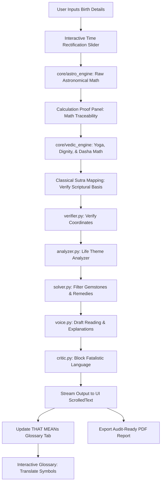

# Betterment Proposal: Trust, Reliability, and System Integration Flow

This document expands on the proposed features designed to increase client-astrologer trust and mathematical reliability, integrating them into the system's operational flow.

---

## 1. Project Reference File Links

All system documentation and audit reports are located in the reference directory:
* [System Documentation](file:///d:/Programs/Python/Astro/Astro_Best/reference/DOCUMENTATION.md)
* [Comprehensive Technical Papers](file:///d:/Programs/Python/Astro/Astro_Best/reference/COMPREHENSIVE_KNOWLEDGE_BASE.md)
* [Multi-Agent Architecture Guide](file:///d:/Programs/Python/Astro/Astro_Best/reference/MULTI_AGENT_ARCHITECTURE.md)
* [Devil's Advocate Audit Report](file:///d:/Programs/Python/Astro/Astro_Best/reference/DEVILS_ADVOCATE_REPORT.md)
* [UI/UX Usability Audit](file:///d:/Programs/Python/Astro/Astro_Best/reference/UI_UX_AUDIT.md)

---

## 2. Integrated Application Flow Chart

This diagram illustrates how the trust-building modules and calculation logs are integrated into the main execution cycle of the application.

---

## 3. Detailed Expansion of Trust and Reliability Features

### Idea 1: The "THAT MEANs" Educational Tab (Mandatory)
* **Detailed Conception**: Vedic astrology uses Devanagari symbols (e.g., मे, वृ, रा) and complex Sanskrit terms (e.g., *Navamsa*, *Mahadasha*, *Ashtakavarga*, *Shadbala*) that are unfamiliar to the lay client. The **"THAT MEANs"** tab acts as an educational bridge.
* **How to Implement**: Build a lookup dictionary in [constants.py](file:///d:/Programs/Python/Astro/Astro_Best/constants.py) mapping every sign abbreviation, Nakshatra lord, and house number to plain-English descriptions of their core significations. Bind mouse-click events on the [RashiChart](file:///d:/Programs/Python/Astro/Astro_Best/ui_widgets.py#L325) canvas. When a user clicks a house cell, highlight the corresponding entry in the "THAT MEANs" tab.
* **Why it Works**: Demystifying the calculations increases the client's confidence in the astrologer's consultation. It shifts the experience from a mysterious, dogmatic prediction to an educational, self-reflective analysis.

### Idea 2: Classical Sutra Mapping and Scriptural Citations
* **Detailed Conception**: Clients are often skeptical of modern astrological interpretations, which can feel arbitrary. Grounding interpretations in classical texts establishes objective authority.
* **How to Implement**: Map detected Yogas and planetary placements in [vedic_engine.py](file:///d:/Programs/Python/Astro/Astro_Best/vedic_engine.py) to their source verses in classical Sanskrit literature (e.g., *Brihat Parashara Hora Shastra, Chapter 34, Verse 12*). Display the Sanskrit text in Devanagari alongside its English translation.
* **Why it Works**: The astrologer can point to historical sources, proving that the software's analysis is not generated or hallucinated by an AI, but is instead a direct application of classical Jyotish principles.

### Idea 3: Mathematical Traceability and Calculation Logs
* **Detailed Conception**: Astrologers need to verify the precision of coordinates before committing to predictions.
* **How to Implement**: Create a collapsible "Calculation Proof" pane at the bottom of the Birth Chart tab. Display the exact Julian Day, Greenwich Mean Sidereal Time (GMST), obliquity parameters, and raw precession offsets (Ayanamsa) returned by [astro_engine.py](file:///d:/Programs/Python/Astro/Astro_Best/astro_engine.py).
* **Why it Works**: Demonstrates calculation integrity. The astrologer can cross-reference these coordinates with ephemeris tables to verify the accuracy of the software, increasing professional trust.

### Idea 4: Non-Fatalistic Remedial Explanations
* **Detailed Conception**: Explaining remedy prescriptions through a logical, behavioral lens makes them more acceptable to modern, analytical clients.
* **How to Implement**: In [solver.py](file:///d:/Programs/Python/Astro/Astro_Best/agents/solver.py), require that every recommended remedy (such as mantras or fasting) explain the mental discipline and psychological traits it develops. For example, explain that Saturn mantras help build patience and structure, which helps the native manage Saturn's restrictions.
* **Why it Works**: Moves the client away from fear-based thinking, framing remedies as tools for personal development rather than magical curse-removal.

### Idea 5: Interactive Birth Time Rectification Slider
* **Detailed Conception**: Birth times are rarely recorded to the second, and a shift of five minutes can change the entire Navamsa (D-9) ascendant.
* **How to Implement**: Add a "Rectification" slider to the date entry panel. When the user drags the slider, adjust the input birth time by seconds or minutes and instantly recalculate planetary and house positions, updating the Rashi and Navamsa charts in real time.
* **Why it Works**: Allows the astrologer to adjust coordinates transparently in front of the client until the divisional charts align with the client's historical life events, showing the precision of the calculations.

---

## 4. Additional Trust and Reliability Features

### Idea 6: Audit-Ready PDF Report Export
* **Detailed Conception**: Consultations are ephemeral, and clients benefit from a permanent record of their analysis.
* **How to Implement**: Create an "Export PDF Report" button in the options panel. Render an HTML template containing the Rashi and Navamsa charts, the calculated planet tables, the mathematical proof values, and the classical sutra citations. Convert this template into a PDF using a local library (such as ReportLab or weasyprint).
* **Why it Works**: A clean, printable report serves as a tangible, high-quality takeaway. It allows the client to review the calculation coordinates and scriptural references long after the consultation has ended, reinforcing trust.

### Idea 7: Local AI Consultation Memory and History Integration
* **Detailed Conception**: Returning clients expect the astrologer and the system to remember past consultations, establishing continuity.
* **How to Implement**: Create a local SQLite database (`consultation_history`) containing past client queries, generated charts, and AI session summaries. When a chart is reloaded, pass the previous session notes to the AI's context window.
* **Why it Works**: Enables context-aware follow-ups. The AI can refer back to previous consultations (e.g. comparing active Dashas from a year ago with current trends), creating a personalized, long-term counseling experience.
